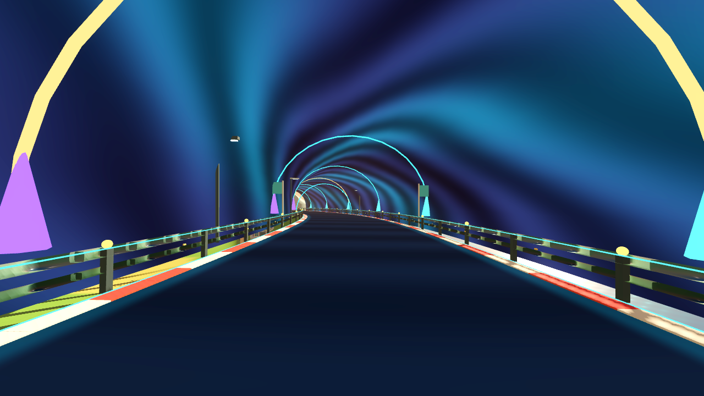
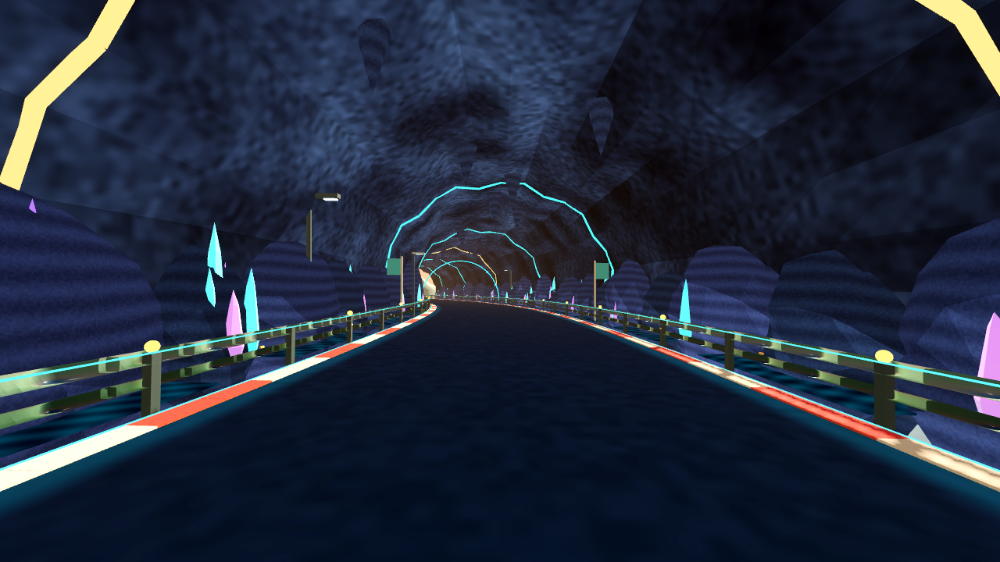

# Sonnenhafen cavern production milestone

Base: `6518a13fb8eb30c81c8a2115d14791cbe7ddd24a` (PR #100, APK 1976).
The preserved before frame comes from the identical resting PR #99 geometry.
All PNGs are untouched Godot 4.6.3 OpenGL framebuffer captures at 1280×720,
using Mesa llvmpipe on Linux. They are not Android/Fold7 performance evidence.

- Outward-only rock folds preserve the original tunnel driving envelope.
- Batched boulders, stalactites, original factory crystal gardens and mineral
  water channels add five material batches. No collision bodies are added.
- High/mobile factory assets contain 324/144 triangles respectively. Binary
  accessors, normals, winding, bounds and manifests are checked before export;
  Blender 4.3.2 independently imported both GLBs (see JSON report).
- Cave/water animation uses the race clock and stops with reduced motion or
  paused race ticks. Detached worlds recover base material energy.
- Actual transformed shoulder mesh bounds stay outside ±5.6 m. Existing
  1.85-km route, eight checkpoints, saves and physics code are retained.

Reproduce:

```sh
python3 -m unittest discover -s tools/tests -p test_ai3d_factory.py -v
python3 tools/ai3d_factory.py --spec tools/ai3d/specs/sonnenhafen_crystal_cavern.json --output-dir build/ai3d --variants
blender --background --threads 1 --python tools/ai3d/verify_blender.py -- build/ai3d/sonnenhafen_biolum_cavern_crystals_variants.json
godot --headless --path . --editor --import --quit
godot --headless --path . --script scripts/tests/kart_cavern_detail_regression.gd
godot --headless --path . --script scripts/tests/kart_darkride_lifecycle_regression.gd
# With a real display or Xvfb:
godot --path . --rendering-method gl_compatibility --script scripts/tests/kart_sonnenhafen_darkride_capture.gd
```




Physical Fold7 frame times, final character/material art direction, full
console-quality equivalence and hardware audio acceptance remain open.
