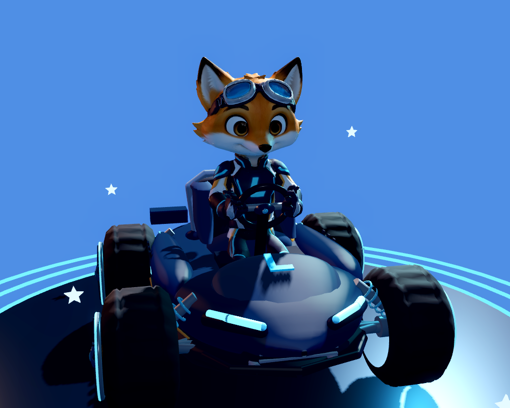
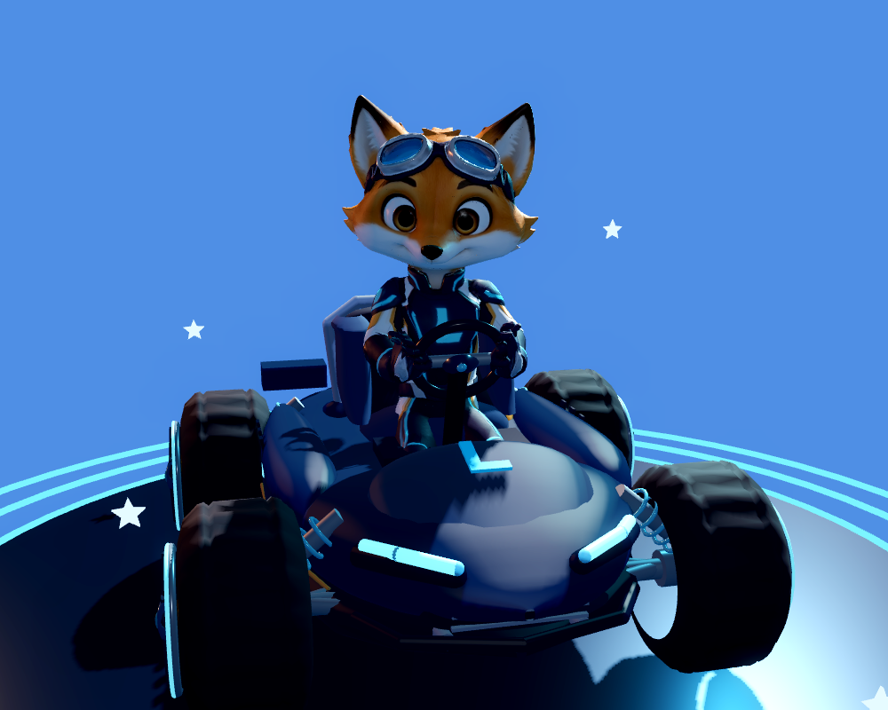

# Original-Lumo: sitzende Animation, Aufmerksamkeit und Landung

## Quellstand und Originalschutz

Basis: `207bfbc5377c0f3e8be800854c83ddf2110ac3f6` (LUMO 2014).

Implementierter Remote-Checkpoint: `03d08ce59ce1e207a69a6f4575d4c35c1ecaacd6` auf
`chatgpt/lumo-character-art-20261111`. Der lokale Prüfcommit
`17d9cf7b5b190c4837a0807ffaaf0294827c2578` hat denselben Dateibaum:
`3b850f5302b24dd6de86c4403c93f4b3051c3a60`. Die Commit-IDs unterscheiden sich,
weil der authentifizierte GitHub-Connector den bereits geprüften Baum publiziert hat.

`assets/characters/lumo_animated/Lumo-Animated-Mobile.glb` bleibt bytegleich:
SHA-256 `3559f700784bc1006905ee3aae01e8bcfbffb95b4f621f7430ce771ba0e3efd5`.
Das tatsächliche Modell enthält ein Mesh, eine Skin, ein Material, 65 Knochen
und neun vorhandene Clips. Es hat **keine** Gesichts-Morphs, Augen- oder Lidknochen.
Gesichtsform, Augen, Brille, Proportionen, Texturen, Rennanzug und Farben werden
nicht verändert. Bestehende Namensnennung und Modelllizenz bleiben erhalten.

Die Original-Referenzmappe `Lumo_Referenzmappe_2026-11-03.pdf` wurde über die
freigegebene Drive-Datei `1bQuAZdoaTk-wCuo5oTfuCt2WDMVhi-R_` gelesen, SHA-256
`d29b4e3709765eb7f179bf7094bc2a3a088cd2428760195780544d99a59b636c`.
Seite 10 zeigt die Originalfigur als Gestaltungsreferenz. Die dortige Jacke
und die Proportionen sind nicht exakt identisch mit dem bereits vorhandenen
Rennanzug-Modell. Dieses vorhandene Modell wird ausdrücklich erhalten.

| Bereich | Vorher | Originalquelle | Umsetzung | Nachweis |
|---|---|---|---|---|
| Sitzende Ruhe | `kart_seated` enthält eine statische Sitzpose; der separate Stand-Idle atmet bereits. | Vorhandener GLB und `tools/lumo_animation/prepare_animations.py` | Langsame, kleine Brust-/Kopfbewegung, 3,8-Sekunden-Zyklus, bei Fahrt schwächer. Keine Skalierung oder Sitzverschiebung. | Tatsächliche Brustknochenmessung und Renderer-Ruheframes. |
| Aufmerksamkeit | Kopf reagiert auf Lenkung; keine Positionsschnittstelle für Garagenauswahl. | Vorhandener `Head`-Knochen, ursprüngliche Blickrichtung +Z. | Weltpunkt-Schnittstelle mit geglätteter Kopfdrehung; höchstens 0,28 rad seitlich und 0,12 rad vertikal. Ziele hinter dem Kopf führen zur Vorwärtspose. | Gedrehtes/verschobenes Kart im Regressionstest; Links-/Rechtsframes. |
| Landung | Sprungclip endet in der Sitzpose; keine eigene kurze Landereaktion. | Bereits angeschlossener `apply_vehicle_sample(..., in_air, ...)`-Pfad. | Einmaliges, 420 ms langes Abfedern nur beim tatsächlichen Wechsel von airborne zu grounded. | Luft-/Boden-Zustandskante, Rückkehr zur Ruhe und kein erneuter Start durch wiederholte Bodensamples. |
| Lenkung/Boost | Visuelle Neigung folgt direkt dem Eingabewert. | Bestehende Lenk- und Boostwerte. | Kleine Körperreaktionen folgen geglättet; echte Lenkradkontakte bleiben direkt gekoppelt. | Vorhandene Kadenz- und Handkontaktprüfungen. |
| Blinzeln/Mimik | Ein zusammenhängendes, an den Kopf gebundenes Gesicht ohne Morphs. | GLB-Inhaltsaudit und ursprünglicher Modellaufbau. | Keine künstliche Augenverformung. Eine echte Erweiterung würde separat modellierte Lid-Morphs, UV-/Normalschutz und erneute Gesichtsabnahme benötigen. | Als offen dokumentiert; keine Blinzelfunktion behauptet. |

## Zuständigkeiten und Integration

Der bestehende Fahrzeugadapter bleibt der einzige Besitzer der 30-Hz-Animationszeit.
Keine konkurrierenden Tweens oder zweite Animationsuhr wurden eingeführt.
Die Änderungen schreiben weder Fahrzeugtransformation, Skalierung, Fahrphysik,
Kollision, Checkpoints, Fortschritt, Belohnungen noch gespeicherte Auswahl.
Die vorhandenen 65 Knochen, neun Clips und Hand-/Lenkrad-Anker werden wiederverwendet.
Es entstehen keine zusätzlichen Meshes, Materialien, Texturen oder Szenenknoten.

Für die Landung ist **kein neuer Hook** in `kart_vehicle.gd` oder `kart_island.gd`
erforderlich: Der bisherige Laufzeitpfad liefert den echten Luftzustand bereits.
Die Garage ist Besitzerin ihres Präsentationsziels und nutzt:

```gdscript
preview_kart.lumo_animation.set_attention_target(world_position)
preview_kart.lumo_animation.clear_attention_target()
```

`set_attention_target` akzeptiert ausschließlich endliche Weltkoordinaten und
liefert `false` bei ungültigen Daten. Es startet keine neue Uhr. Ein bewegtes Ziel
kann aktualisiert werden; ohne weitere Aufrufe bleibt der letzte Punkt bestehen.
`clear_attention_target` führt geglättet zur Vorwärtspose zurück. Es werden nur
Kopfknochen gedreht, keine getrennte Pupillenbewegung erzeugt. Die Garage muss den
Aufruf nach dem Erzeugen des tatsächlich sichtbaren Preview-Karts ausführen.
Der bisherige Auswahl-Nicker wurde vor dem Fahrzeugwechsel auf dem anschließend
gelöschten Preview abgespielt; dessen Verlagerung in die neue Vorschau gehört zum
separaten Garagenbeitrag.

Pause hält Uhr, Pose und Landereaktion an. Wiederaufnahme setzt die angehaltene
Bewegung fort. Reduzierte Bewegung verwirft ausstehende Landereaktionen und
deaktiviert Atem-/Aufmerksamkeitsüberlagerungen. Beim Abschalten des Ruhemodus
wird keine alte Landung nachgespielt. Originale Nicker- und Erfolgsclips bleiben
nutzbar und kehren zur Sitzpose zurück.

## Automatisierte Prüfungen

Ausgeführt mit Godot `4.6.3.stable.official.7d41c59c4`, Linux/headless und dem
tatsächlich importierten Originalmodell. Alle vier Programme endeten regulär;
ihre Logs enthalten keine Skriptfehler, `ERROR:`, ObjectDB- oder RID-Leaks.
Die Zahlen sind **Assertions**, nicht tausende unabhängige Testfälle.

| Programm | Assertions | Fehler | Zweck |
|---|---:|---:|---|
| `lumo_attention_landing_regression.gd` | 1843 | 0 | Originalhash, reale Knochenbewegung, Weltkoordinaten, Begrenzung/Glättung, letzte Auswahl, Landekante, Pause, Wiederaufnahme, reduzierte Bewegung und Freigabe. |
| `lumo_kart_tick_cadence_regression.gd` | 1196 | 0 | Bestehende Kadenz bei 30/50/60/75/90/120/144 Eingabeschritten pro Sekunde, variable Zeitabstände, Aussetzer und Wiederaufnahme. |
| `lumo_gesture_contact_regression.gd` | 200 | 0 | Nicken in Menü und Zielauslauf bei 60/120 Eingabeschritten pro Sekunde. |
| `lumo_kart_animation_review.gd` | 379 | 0 | Sitz-, Lenk-, Sprung-, Treffer- und Erfolgsposen; Sitzbeine, Handkontakt und unverändertes Chassis. |

Größter gemessener Hand-Ankerabstand in diesen Läufen: rund **1,150 mm**.
Das ist eine Messung der tatsächlich berechneten Hand-/Lenkradanker im Test,
keine Aussage über Fingerkollisionen oder Android-Frameraten. CPU-Werte im alten
Gesten-Testlog stammen aus dieser Desktop-Prüfung und sind kein Gerätebenchmark.

## Rendererbeleg und Abnahmegrenzen

`scripts/tests/lumo_attention_capture.gd` verwendet das echte Produktionskart und
den ursprünglichen GLB, eine identische Kamera und dieselbe explizite Zeitleiste
gegen beide Adapterstände. Die Fahrzeugzustände werden im Fixture vorgegeben;
der Clip ist **kein Nachweis einer normalen vollständigen Sonnenhafen-Fahrt**.
Das übernimmt die separate Integrationsabnahme.

Abgeschlossener Vergleich: 1000 × 800 Pixel, Fahrzeugqualität medium, tatsächlicher
Compatibility-Renderer auf Linux/Mesa llvmpipe. Kamera `(0.85, 1.90, -3.75)` auf
`(0, 1.0, -0.10)`, FOV 37. Je 114 Bilddateien ergeben 7,6 Sekunden mit 15 Bildern
pro Wiedergabesekunde. Diese Wiedergabezahl ist **keine gemessene Bildrate**.
Beide Läufe endeten regulär mit **114/114 erzeugten Frames, null Capture-Fehlern**.
Die finalen Logs enthalten keine Skript-/Rendererfehler oder Ressourcenlecks;
die bekannten Compatibility-Hinweise zu VSync, Screen-Space-AA und volumetrischem
Nebel werden nicht als vorhandene Effekte dargestellt. Die PNG-Stichproben für
Ruhe, linken/rechten Blick und Landung wurden visuell geprüft: Originalgesicht
und Proportionen bleiben erhalten, der Kopf dreht sichtbar, die Landereaktion
bleibt klein und beide Hände liegen am Lenkrad. FFprobe bestätigt für beide
fertigen MP4s 1000 × 800, 114 Frames und 7,6 Sekunden.

| Identischer Zeitpunkt / Kamera | Vorher | Nachher |
|---|---|---|
| Blick auf das seitliche Ziel |  |  |
| Gesamte Zustandsfolge | [Originaladapter-Clip](lumo-before.mp4) | [Erweiterter Adapter-Clip](lumo-after.mp4) |
| Aufnahmebedingungen | [Before-Metadaten](capture-before.json) | [After-Metadaten](capture-after.json) |

`capture-manifest.json` enthält Hashes aller ursprünglichen 228 PNG-Frames und
der ausgelieferten Ausschnitte/Clips. Die große reproduzierbare Rohbildsequenz
bleibt außerhalb des Repositorys; die originalen PNG-Stichproben, beide MP4s,
Metadaten, Logs und Capture-Skript werden mit diesem Nachweis gesichert.

Android-Emulator, echte Android-Hardware, Fold7, GPU-FPS, Temperatur und RAM wurden
für diesen isolierten Beitrag nicht geprüft. Es wurde kein APK gebaut oder
veröffentlicht und kein Merge nach main vorgenommen.

## Gezielte Klärung eines vorhandenen Sitz-/Karosserie-Clippings

Die unabhängige Prüfung des integrierten Garage-Clips, Seitenansicht Gecko Velo,
zeigte einen Schuh unterhalb der Karosserie. Dieser Befund wurde ausdrücklich
nachgeprüft: Der Adapter wurde direkt aus `207bfbc5377c0f3e8be800854c83ddf2110ac3f6`
extrahiert und mit demselben unveränderten Fahrzeug und Originalmodell geladen.
Die [echte Original-Seitenaufnahme](seat-diagnosis/original-gecko-side.png) zeigt
das gleiche sichtbare Sitz-/Karosserieproblem bereits im Ausgangsstand.

Der zusätzliche numerische Vergleich der reduzierten Sitzpose `kart_seated@0.3`
ergibt für Original und Erweiterung exakt gleiche JSON-Zahlenwerte aller **65
Knochen-Globaltransformationen**, der einzigen Skin-Mesh-Transformation und der
Actor-Transformation. Der Modellhash ist ebenfalls gleich. Die Fußknochen liegen
in beiden Läufen bei etwa `y = 0,194513`; dies ist eine Knochenmessung, keine
Kontaktmessung an Pedal oder Schuhsohle. Der Probe-Pedalpfad liefert wegen der
vorhandenen Mesh-Zusammenfassung keine benannten Pedalobjekte und wird nicht als
erfolgreiche Pedalmessung gewertet.

Das Clipping bleibt als **vorbestehender Fehler der Sitz-/Fahrzeuganpassung**
offen. Dieser Beitrag ändert weder Beinpose noch Mesh und behebt den ursprünglichen
Sitzfehler nicht. Die vorhandenen 379 Adapter-Assertions wurden zusätzlich gegen
den integrierten Stand `fced6857f45f321c59b5dc6285bda23cf84e0fe7` erneut ausgeführt:
379 bestanden, 0 fehlgeschlagen, reguläres Ende. Der maximale Hand-Ankerabstand
betrug 1,142929 mm ([Integrationslog](seat-diagnosis/integrated-original-adapter.log)).

[Vergleichsmetadaten und Datei-Hashes](seat-diagnosis/comparison.json),
[Originalpose](seat-diagnosis/original-pose.json),
[erweiterte Pose](seat-diagnosis/current-pose.json) und
[Rendererlog](seat-diagnosis/original-renderer.log) sichern die Abgrenzung.
Das [Probe-Skript](seat-diagnosis/probe.gd) nimmt zwei Benutzerargumente entgegen:
Ausgabeordner und zu ladenden Adapterpfad. Die Originaldatei lässt sich mit
`git show 207bfbc5377c0f3e8be800854c83ddf2110ac3f6:scripts/characters/lumo/lumo_kart_animation_adapter.gd`
extrahieren; der neue Pfad ist `res://scripts/characters/lumo/lumo_kart_animation_adapter.gd`.
Die Seitenaufnahme nutzt 1000 × 800 Pixel, Kamera `(4.4, 1.05, 0)` auf
`(0, 0.90, 0)`, FOV 37. Sie ist ein gezielter Originalbefund und kein zweiter
kompletter Vorher-/Nachher-Animationsclip.
